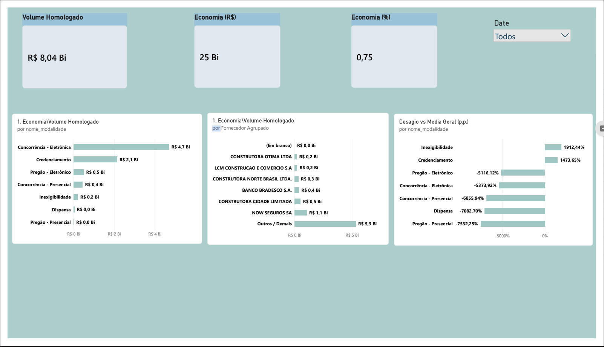

# Dashboard Executivo: Inteligência de Compras PNCP (Power BI)



##  Visão Geral do Projeto

Este projeto entrega um dashboard executivo limpo, profissional e responsivo em formato 16:9, desenvolvido no Power BI com foco na auditoria e análise de dados de compras públicas do **PNCP (Portal Nacional de Contratações Públicas)**. Desenhado especificamente para a Controladoria e alta gestão (C-level), o painel destaca volumes de contratação, concentração de fornecedores e eficiência de preços através de um layout em três níveis.


## Estrutura e Layout do Dashboard


O dashboard está estruturado em três blocos visuais principais otimizados para leitura executiva rápida:

1. **Seção Superior:** Cartões de visão geral e principais indicadores (KPI cards).

2. **Seção Intermédia (Lado a Lado):**

   * **Volume Homologado por Modalidade:** Gráfico de barras horizontais exibindo a distribuição do poder de compra por modalidade licitatória.

   * **Top 6 Fornecedores vs. "Outros" (Gráfico de Barras Horizontais):** Análise granular de fornecedores agrupando a cauda longa numa categoria consolidada para evitar poluição visual.

3. **Seção Inferior (Base):**

   * **Deságio vs. Média Geral (p.p.) (Gráfico de Barras Verticais):** Avalia o desempenho de desconto por modalidade de contratação comparado à linha de base global.
  
## Perguntas do negocio


-- PROJETO AVALIATIVO - MÓDULO 2
-- Ficheiro: sql/02_perguntas.sql
-- Objetivo: Respostas formais às 6 Perguntas de Negócio da Controladoria


USE pncp_controladoria;

-- ------------------------------------------------------------------------------
-- PERGUNTA 1: Economia global do Poder Público
-- Qual é o percentual e o valor financeiro nominal economizado pelo governo 
-- (diferença entre valor estimado e valor homologado)?
-- Regra de negócio: A economia só entra nos itens comparáveis (comparavel = 1).
-- Credenciamento (modalidade_id = 12) e distorções ficam fora da taxa de deságio.
-- ------------------------------------------------------------------------------
SELECT 
    SUM(valor_total_homologado) AS volume_total_homologado,
    SUM(CASE WHEN comparavel = 1 THEN valor_total_estimado ELSE 0 END) AS valor_estimado_comparavel,
    SUM(CASE WHEN comparavel = 1 THEN valor_total_homologado ELSE 0 END) AS valor_homologado_comparavel,
    SUM(economia_valor) AS economia_nominal_reais,
    ROUND((SUM(economia_valor) / NULLIF(SUM(CASE WHEN comparavel = 1 THEN valor_total_estimado ELSE 0 END), 0)) * 100, 2) AS taxa_economia_desagio_pct,
    COUNT(CASE WHEN comparavel = 1 THEN 1 END) AS itens_comparaveis,
    COUNT(*) AS total_itens_base
FROM fato_item_contratado;


-- ------------------------------------------------------------------------------
-- PERGUNTA 2: Concentração e risco de fornecedores
-- Quem são os maiores fornecedores em volume financeiro e qual percentual 
-- do orçamento público está concentrado neles?
-- Mostra os 10 maiores adjudicatários e o percentual sobre o orçamento global.
-- ------------------------------------------------------------------------------
SELECT 
    f.ni_fornecedor AS identificador_fiscal,
    f.nome_fornecedor,
    f.porte,
    f.tipo_pessoa,
    SUM(fat.valor_total_homologado) AS volume_homologado_fornecedor,
    ROUND(
        (SUM(fat.valor_total_homologado) / (SELECT SUM(valor_total_homologado) FROM fato_item_contratado)) * 100, 
        2
    ) AS participacao_orcamento_pct
FROM fato_item_contratado fat
JOIN dim_fornecedor f ON fat.sk_fornecedor = f.sk_fornecedor
GROUP BY f.ni_fornecedor, f.nome_fornecedor, f.porte, f.tipo_pessoa
ORDER BY volume_homologado_fornecedor DESC
LIMIT 10;


-- ------------------------------------------------------------------------------
-- PERGUNTA 3: Eficácia por modalidade
-- Quais modalidades licitatórias trazem maior deságio/economia e quais 
-- concentram o maior volume de recursos?
-- ------------------------------------------------------------------------------
SELECT 
    m.nome_modalidade,
    COUNT(fat.sk_fato) AS qtd_itens,
    SUM(fat.valor_total_homologado) AS volume_homologado,
    ROUND(
        (SUM(fat.valor_total_homologado) / (SELECT SUM(valor_total_homologado) FROM fato_item_contratado)) * 100, 
        2
    ) AS participacao_volume_pct,
    SUM(fat.economia_valor) AS economia_nominal_reais,
    ROUND(
        (SUM(fat.economia_valor) / NULLIF(SUM(CASE WHEN fat.comparavel = 1 THEN fat.valor_total_estimado ELSE 0 END), 0)) * 100, 
        2
    ) AS desagio_pct
FROM fato_item_contratado fat
JOIN dim_modalidade m ON fat.sk_modalidade = m.sk_modalidade
GROUP BY m.nome_modalidade
ORDER BY volume_homologado DESC;


-- ------------------------------------------------------------------------------
-- PERGUNTA 4: Tempo do ciclo de compras
-- Qual a duração média (em dias) entre o lançamento do edital e a sua 
-- homologação final, segmentada por órgão?
-- Regra de negócio: Agrupa pelo NOME padronizado do órgão, considera apenas
-- itens com ciclo válido (COUNT(dias_ciclo)) e filtra órgãos com 5 ou mais certames.
-- ------------------------------------------------------------------------------
SELECT 
    o.nome_orgao,
    COUNT(fat.dias_ciclo) AS certames_com_ciclo,
    COUNT(DISTINCT o.cnpj_orgao) AS unidades_compradoras_distintas,
    ROUND(AVG(fat.dias_ciclo), 1) AS ciclo_medio_dias,
    MAX(fat.dias_ciclo) AS ciclo_maximo_dias,
    MIN(fat.dias_ciclo) AS ciclo_minimo_dias
FROM fato_item_contratado fat
JOIN dim_orgao o ON fat.sk_orgao = o.sk_orgao
WHERE fat.dias_ciclo IS NOT NULL
GROUP BY o.nome_orgao
HAVING COUNT(fat.dias_ciclo) >= 5
ORDER BY ciclo_medio_dias DESC;


-- ------------------------------------------------------------------------------
-- PERGUNTA 5: Distribuição regional
-- Quais estados e regiões concentram as maiores despesas e quais 
-- apresentam os melhores indicadores de desconto?
-- ------------------------------------------------------------------------------
SELECT 
    l.regiao,
    l.uf_sigla,
    COUNT(DISTINCT fat.sk_orgao) AS unidades_compradoras,
    COUNT(fat.sk_fato) AS total_itens,
    SUM(fat.valor_total_homologado) AS volume_homologado,
    ROUND(
        (SUM(fat.valor_total_homologado) / (SELECT SUM(valor_total_homologado) FROM fato_item_contratado)) * 100, 
        2
    ) AS participacao_despesa_pct,
    ROUND(
        (SUM(fat.economia_valor) / NULLIF(SUM(CASE WHEN fat.comparavel = 1 THEN fat.valor_total_estimado ELSE 0 END), 0)) * 100, 
        2
    ) AS desagio_pct
FROM fato_item_contratado fat
JOIN dim_localidade l ON fat.sk_localidade = l.sk_localidade
GROUP BY l.regiao, l.uf_sigla
ORDER BY volume_homologado DESC;


-- ------------------------------------------------------------------------------
-- PERGUNTA 6: Perfil dos gastos
-- Como os recursos se distribuem entre bens, serviços e obras e engenharia?
-- ------------------------------------------------------------------------------
SELECT 
    perfil_gasto,
    COUNT(*) AS total_itens,
    SUM(valor_total_homologado) AS volume_homologado,
    ROUND(
        (SUM(valor_total_homologado) / (SELECT SUM(valor_total_homologado) FROM fato_item_contratado)) * 100, 
        2
    ) AS participacao_volume_pct,
    ROUND(SUM(valor_total_homologado) / COUNT(*), 2) AS ticket_medio_por_item_reais,
    ROUND(
        (SUM(fat.economia_valor) / NULLIF(SUM(CASE WHEN fat.comparavel = 1 THEN fat.valor_total_estimado ELSE 0 END), 0)) * 100, 
        2
    ) AS desagio_pct
FROM fato_item_contratado fat
GROUP BY perfil_gasto
ORDER BY volume_homologado DESC;


##  Modelo de Dados e Esquema Relacional

O modelo relacional em estrela (*Star Schema*) é composto por tabelas de dimensão otimizadas ligadas à tabela fato transacional:

```
dim_modalidade (1) -------< fato_item_contratado (*)
dim_fornecedor (1) -------< fato_item_contratado (*)

```

* **`dim_modalidade`**: Modalidades de contratação extraídas e normalizadas do PNCP.

* **`dim_fornecedor`**: Dados mestres de fornecedores aprimorados com lógica de agrupamento e ordenação personalizada.

* **`fato_item_contratado`**: Tabela transacional de itens contratados capturando valores estimados, valores homologados e métricas de desempenho.

## Principais Cálculos DAX e Otimizações

### 1. Volume Homologado

```
Volume Homologado = SUM(fato_item_contratado[valor_total_homologado])

```

### 2. Agrupamento de Fornecedores (Top 6 + "Outros / Demais")

Para evitar erros de capacidade de memória (estouro com `RANKX` em colunas calculadas) e manter uma distribuição limpa:

```
Fornecedor Agrupado = 
VAR _Total = CALCULATE(SUM(fato_item_contratado[valor_total_homologado]))
VAR _Ranking = 
    IF(
        ISBLANK(_Total) || _Total = 0,
        BLANK(),
        RANKX(
            ALL(dim_fornecedor),
            CALCULATE(SUM(fato_item_contratado[valor_total_homologado])),
            ,
            DESC,
            Dense
        )
    )
RETURN
IF(
    ISBLANK(_Ranking),
    BLANK(),
    IF(_Ranking <= 6, dim_fornecedor[nome_fornecedor], "Outros / Demais")
)

```

### 3. Deságio vs. Média Geral (p.p.)

Calcula a economia percentual comparando o desconto de cada modalidade contra a linha de base global:

```
Desagio vs Media Geral (p.p.) = 
VAR _DesagioModalidade = 
    DIVIDE(
        SUM(fato_item_contratado[valor_total_estimado]) - SUM(fato_item_contratado[valor_total_homologado]),
        SUM(fato_item_contratado[valor_total_estimado]),
        0
    )
VAR _MediaGeral = 
    CALCULATE(
        DIVIDE(
            SUM(fato_item_contratado[valor_total_estimado]) - SUM(fato_item_contratado[valor_total_homologado]),
            SUM(fato_item_contratado[valor_total_estimado]),
            0
        ),
        ALL(dim_modalidade)
    )
RETURN
(_DesagioModalidade - _MediaGeral) * 100

```

## Sprints (Metodologia Ágil)

O desenvolvimento deste painel foi planejado e executado em 3 Sprints de 1 semana cada, focando na entrega iterativa de valor para a Controladoria:


### 🟢 Sprint 1: Fundação, Ingestão e Modelo de Dados (Semana 1)

* **Objetivo:** Estabelecer a infraestrutura de dados e relacionamentos sem sobrecarregar a memória do Power BI.

* **Backlog Executado:**

  * Conexão e limpeza inicial das bases do PNCP.

  * Criação do modelo em estrela entre `dim_modalidade`, `dim_fornecedor` e `fato_item_contratado`.

  * Resolução de erros de capacidade através da otimização de medidas e exclusão de colunas calculadas redundantes.

* **Entregável:** Modelo de dados íntegro e testado contra estouros de memória.

### 🟡 Sprint 2: Métricas DAX e Construção dos Visuais (Semana 2)

* **Objetivo:** Desenvolver os cálculos centrais e estruturar o layout nos três níveis visuais.

* **Backlog Executado:**

  * Desenvolvimento da medida de `Volume Homologado`.

  * Criação da lógica otimizada para o Top 6 + "Outros / Demais" em `dim_fornecedor`.

  * Implementação da medida de `Desagio vs Media Geral (p.p.)` utilizando o delta entre valores estimados e homologados.

  * Montagem dos gráficos de barras horizontais e verticais na tela.

* **Entregável:** Dashboard funcional com todas as métricas calculadas e exibidas.

### 🔵 Sprint 3: Polimento Executivo, Identidade Visual e Homologação (Semana 3)

* **Objetivo:** Garantir a responsividade 16:9, aplicação do tema corporativo e validação com os stakeholders.

* **Backlog Executado:**

  * Importação e aplicação do tema corporativo customizado (`tema_executivo.json`).

  * Ativação e formatação de rótulos de dados (*Data Labels*) para leitura rápida.

  * Ajuste de margens e alinhamentos para assegurar ausência total de barras de rolagem.

  * Homologação final com a Controladoria.

* **Entregável:** Produto pronto para apresentação C-level e publicação no Power BI Service.

## Identidade Visual e Tema

O dashboard utiliza um tema de conformidade corporativa para assegurar sobriedade, formalidade e legibilidade imediata:

* **Fundo da Tela (Canvas):** Off-White / Cinza Gelo (`#F4F5F7`)

* **Elementos Primários:** Azul Marinho Executivo (`#0F172A`)

* **Elementos Secundários:** Azul Petróleo / Teal (`#0D9488` / `#0EA5E9`)

* **Métricas de Economia / Positivas:** Verde Corporativo (`#10B981`)

* **Agrupamento de Cauda ("Outros"):** Cinza Chumbo Suave (`#64748B`)
